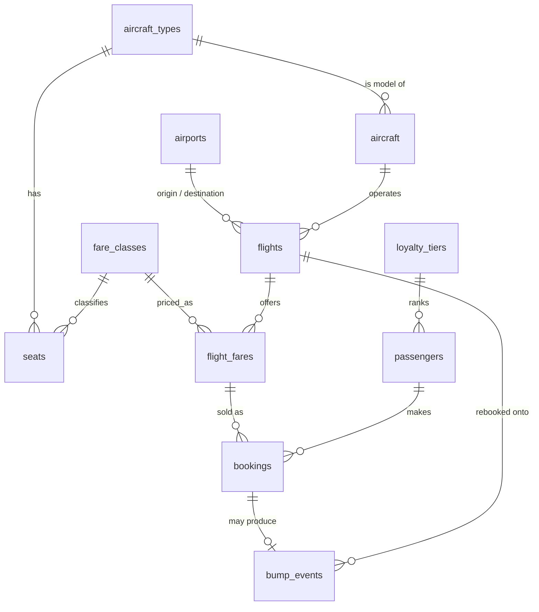

# CSC 370 Term Project: Airline Seat Reservation with Overbooking

A MySQL database for an airline that sells more tickets than seats (overbooking) and bumps the lowest-priority passengers at check-in, with compensation. Priority is decided by fare class and loyalty tier.

Solo project, Fall 2026, UVic CSC 370.

Zoriyon Zion 
V# - V01029666

## Run it

```bash
mysql -u root < schema.sql
mysql -u root < seed.sql
mysql -u root < queries.sql
```

## ERD



## Normalisation (BCNF)

Every non-trivial functional dependency has a superkey on its left side.

| Table | Key | Dependencies |
|---|---|---|
| airports | airport_code | airport_code -> name, city, country |
| fare_classes | fare_class_code | code -> name, priority_rank (name and rank are also candidate keys) |
| loyalty_tiers | tier_id | tier_id -> name, bump_priority, multiplier (name and priority are also keys) |
| aircraft_types | type_id | type_id -> model, manufacturer; model is a candidate key |
| seats | (type_id, seat_row, seat_letter) | key -> fare_class_code |
| aircraft | tail_number | tail_number -> type_id |
| flights | flight_id | flight_id -> all; (flight_number, departure_time) is a candidate key |
| flight_fares | (flight_id, fare_class_code) | key -> seats_allocated, overbook_pct, price |
| passengers | passenger_id | passenger_id -> all; email is a candidate key |
| bookings | booking_id | booking_id -> all; (passenger_id, flight_id) and (flight_id, seat) are candidate keys |
| bump_events | bump_id | bump_id -> all; booking_id is a candidate key |

**Design decision:** a single `aircraft(tail_number, model, manufacturer, ...)` table would have `model -> manufacturer`, where `model` is not a key. That violates BCNF. Splitting into `aircraft_types` and `aircraft` fixes it, and the seat map lives on the type instead of being copied for every plane of that model.

## Known limitations (next sprint)

- A booking's seat is not yet checked against the seat map of the flight's aircraft type (needs a trigger or a redesign).
- Bumping is demonstrated as a query only. It is not yet a transaction.
- Dataset is tiny. Indexing and performance work needs generated data.
