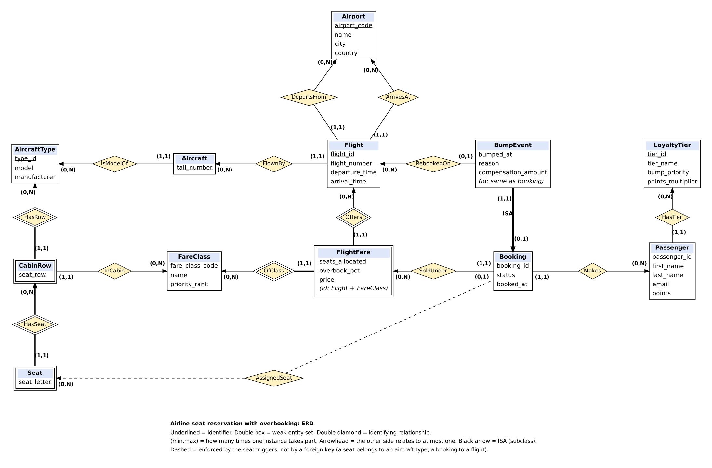

**Zoriyon Zion (V01029666)**

# CSC 370 Term Project: Airline Seat Reservation with Overbooking

A MySQL database for an airline that sells more tickets than seats (overbooking) and bumps the lowest-priority passengers at check-in, with compensation. Priority is decided by fare class and loyalty tier.

Solo project, Fall 2026, UVic CSC 370. Needs MySQL 8.0.16 or newer (CHECK constraints, window functions, recursive CTEs, triggers).

## Run it

```bash
mysql -u root < schema.sql          # builds the database (wipes and recreates "airline")
mysql -u root < seed.sql            # sample data
mysql -u root -t < queries.sql      # demo queries Q1 to Q6
mysql -u root -t < demo_bump.sql    # subclass demo: a bump, then rolled back
bash run_seat_tests.sh              # Goal 1: seat rules, 3 valid + 4 invalid
bash run_constraint_tests.sh        # Goal 2: one test per constraint, 48 + 3 audits
```

Files: `schema.sql`, `seed.sql`, `queries.sql`, `demo_bump.sql`, `run_seat_tests.sh`, `run_constraint_tests.sh`, `constraints_relational_algebra.md`, `erd.png` / `erd.svg` / `erd.dot`.

## ERD



Every entity set has an underlined identifier. Weak entity sets (CabinRow, Seat, FlightFare) are identified through the entity sets they depend on. Each edge is labelled (min,max) as in Lesson 05, and an arrowhead points at the side that is "at most one".

### Does every line match the tables?

I checked each relationship against `schema.sql`. NOT NULL on the foreign key column gives min 1, a nullable column gives min 0, and a key that makes the column unique gives max 1.

| Relationship | Implemented as | Multiplicity and why |
|---|---|---|
| IsModelOf | `aircraft.type_id` → `aircraft_types` | Aircraft (1,1): column is NOT NULL. AircraftType (0,N): nothing forces a type to have planes. |
| HasRow (identifying) | `cabin_rows.type_id`, part of the key | CabinRow (1,1). AircraftType (0,N). |
| HasSeat (identifying) | `seats (type_id, seat_row)` → `cabin_rows` | Seat (1,1). CabinRow (0,N). |
| InCabin | `cabin_rows.fare_class_code` | CabinRow (1,1): NOT NULL. FareClass (0,N). |
| FlownBy | `flights.tail_number` | Flight (1,1): NOT NULL. Aircraft (0,N). |
| DepartsFrom / ArrivesAt | `flights.origin` / `flights.destination` | Flight (1,1) each. Airport (0,N). |
| Offers (identifying) | `flight_fares.flight_id`, part of the key | FlightFare (1,1). Flight (0,N). |
| OfClass (identifying) | `flight_fares.fare_class_code`, part of the key | FlightFare (1,1). FareClass (0,N). |
| HasTier | `passengers.tier_id` | Passenger (1,1): NOT NULL, default 1. LoyaltyTier (0,N). |
| Makes | `bookings.passenger_id` | Booking (1,1). Passenger (0,N). |
| SoldUnder | `bookings (flight_id, fare_class_code)` → `flight_fares` | Booking (1,1): a booking must be on a fare the flight actually sells. FlightFare (0,N). |
| AssignedSeat (dashed) | `bookings.seat_row, seat_letter`, checked by triggers | Booking (0,1): seat is NULL until check-in. Seat (0,N): the same seat is used by many flights, but `UNIQUE (flight_id, seat_row, seat_letter)` limits it to one booking per flight. |
| RebookedOn | `bump_events.rebooked_flight_id` | BumpEvent (0,1): NULL means not rebooked. Flight (0,N). |
| ISA | `bump_events.booking_id` is the primary key AND a foreign key to `bookings` | BumpEvent (1,1): it is always a booking. Booking (0,1): a booking is bumped at most once. |

In the kick-off ERD (Mermaid), the RebookedOn line was drawn as exactly one flight, but `rebooked_flight_id` is nullable, so it is really zero or one. The new ERD fixes that.

## Normalisation (BCNF)

In every table, the left side of each non-trivial functional dependency is a superkey.

| Table | Key | Dependencies |
|---|---|---|
| airports | airport_code | airport_code → name, city, country |
| fare_classes | fare_class_code | code → name, priority_rank. name and priority_rank are also candidate keys. |
| loyalty_tiers | tier_id | tier_id → tier_name, bump_priority, points_multiplier. tier_name and bump_priority are also keys. |
| aircraft_types | type_id | type_id → model, manufacturer. model is also a key. |
| **cabin_rows** (new) | (type_id, seat_row) | (type_id, seat_row) → fare_class_code |
| **seats** (changed) | (type_id, seat_row, seat_letter) | Only the trivial dependency: every attribute is in the key. |
| aircraft | tail_number | tail_number → type_id |
| flights | flight_id | flight_id → all. (flight_number, departure_time) is also a key. |
| flight_fares | (flight_id, fare_class_code) | key → seats_allocated, overbook_pct, price |
| passengers | passenger_id | passenger_id → all. email is also a key. |
| bookings | booking_id | booking_id → all. (passenger_id, flight_id) and (flight_id, seat_row, seat_letter) are also keys. |
| bump_events | booking_id | booking_id → bumped_at, reason, compensation_amount, rebooked_flight_id |

**What changed since the kick-off, and why.** At the kick-off, `seats` was `(type_id, seat_row, seat_letter, fare_class_code)`. Cabins are made of whole rows, so `(type_id, seat_row) → fare_class_code` holds, but `(type_id, seat_row)` is not a key of `seats` because every letter in a row shares it. That is a BCNF violation, and it also stored the cabin once per seat (180 times for a 737) instead of once per row (30 times). Following the BCNF decomposition algorithm from Lesson 07, I took the violating dependency X → Y, set R1 = X⁺ = `cabin_rows(type_id, seat_row, fare_class_code)` and R2 = the rest plus X = `seats(type_id, seat_row, seat_letter)`. The join of the two gives back the original, so it is lossless. Q2 returns the same seat counts as before.

**A dependency I deliberately do not assume:** `points → tier_id`. A passenger's tier is awarded status (qualification, status matches), not a function of the current points balance, so `passengers` stays in BCNF.

## Design decision for Goal 1: how to enforce "the seat exists on the flight's aircraft"

A booking knows its flight, but a seat belongs to an aircraft **type**. The type is reachable only through `flights → aircraft`. I compared two ways to enforce the rule.

| | A: composite foreign key | B: triggers (chosen) |
|---|---|---|
| How | Add `type_id` to `flights` and `bookings`, then `FOREIGN KEY (type_id, seat_row, seat_letter) REFERENCES seats` | `BEFORE INSERT` and `BEFORE UPDATE` triggers on `bookings` look up the seat through the flight's aircraft |
| Normal form | **Breaks BCNF twice.** In `flights`, `tail_number → type_id` holds but `tail_number` is not a key. In `bookings`, `flight_id → type_id` holds but `flight_id` is not a key. A plane could be swapped on a flight and leave stale copies of `type_id`. | Stays in BCNF. No redundant columns. |
| Declarative? | Yes, the DBMS checks it as a normal constraint | No, it is procedural code, so it is not visible in the ERD |
| Evidence | | `run_seat_tests.sh`: 3 valid seats accepted, 3 invalid seats rejected, plus a 4th test that an UPDATE can't dodge the check |

I chose B because the course's measure of schema quality is normalisation, and A would trade two BCNF violations for one declarative constraint. The cost of B is that the rule lives in triggers, which I list as a known weakness. The relational algebra form of the rule is `SEAT-exists` in `constraints_relational_algebra.md`; its left side contains `a.type_id`, which comes out of a join, so no `FOREIGN KEY` clause can state it.

The triggers also check a second rule: the seat's cabin must match the booked fare class (`SEAT-cabin`).

## Design decision for Goal 3: weak entities and the subclass

**Weak entity sets.** `CabinRow` makes sense only inside an aircraft type, and `Seat` only inside a row, so their identifiers are `(type_id, seat_row)` and `(type_id, seat_row, seat_letter)`, built from their supporting entity sets. A surrogate `seat_id` would hide that and would still need a UNIQUE constraint on the natural key. `FlightFare` is identified by a flight AND a fare class, which is why it has two identifying relationships.

**`BumpEvent` as a subclass of `Booking`.** I compared two mappings:

| | Own table (chosen): `bump_events(booking_id PK/FK, ...)` | One table: bump columns inside `bookings` |
|---|---|---|
| NULLs | None. Only bumped bookings have a row. | Four nullable columns, NULL for almost every booking. Functional dependencies involving NULL columns become ambiguous (L3: "impact of NULL values on FDs"). |
| Normal form | BCNF: booking_id → all | Also in BCNF, but only if NULL is read as "not applicable" |
| Declarative rule "bump columns present exactly when status = 'bumped'" | **Not possible** with a foreign key alone. Listed under rules not enforced yet. | Possible with one CHECK constraint |
| `rebooked_flight_id` foreign key | Clean | Works, but mixed in with unrelated booking columns |
| Queries | Needs a join on `booking_id` (see `demo_bump.sql`) | No join |

I picked the own table because it keeps `bookings` free of NULL-heavy columns and models "a bump is a special kind of booking" directly: the subclass reuses the booking's identifier as its own. The price is that the status link is not enforced yet (see limitations).

## Results since the kick-off

| Goal | Success criterion | Evidence |
|---|---|---|
| 1. Seat rule | 3 invalid seats rejected, 3 valid accepted, dependency table updated | `bash run_seat_tests.sh` → 7 passed, 0 failed. BCNF table above updated. |
| 2. Constraints in relational algebra | Every key and foreign key (14 now, 13 at the kick-off) plus the seat rule, each linked to a failing-insert test | `constraints_relational_algebra.md` and `bash run_constraint_tests.sh` → 48 tests + 3 audits, all passed |
| 3. ERD with weak entities and inheritance | Updated ERD, a comparison with a recommendation, schema still in BCNF | ERD above, the comparison above, BCNF table above, `demo_bump.sql` |
| Teaching team: identifiers and multiplicity in the ERD | Identifiers shown, each line checked against the tables | ERD and the check table above |

## Known limitations

- **The overbooking limit itself is not enforced.** Nothing stops an 8th booking on a fare whose limit is 7 (`NE-max-sellable`). It holds on the sample data and is checked by an audit test, but it is an aggregate rule, so it needs a transaction with locking to be safe under concurrent bookings.
- **The bump is not consistent by construction.** A booking can be marked 'bumped' without a bump event and the reverse (`NE-bump-has-bumped-booking`, `NE-bumped-booking-has-event`). `demo_bump.sql` does both steps together in one transaction, but the schema does not force it.
- **The seat rules live in triggers**, not in a declarative constraint (see the design decision).
- The dataset is tiny (3 flights, 8 passengers). Indexing and performance work needs generated data.
